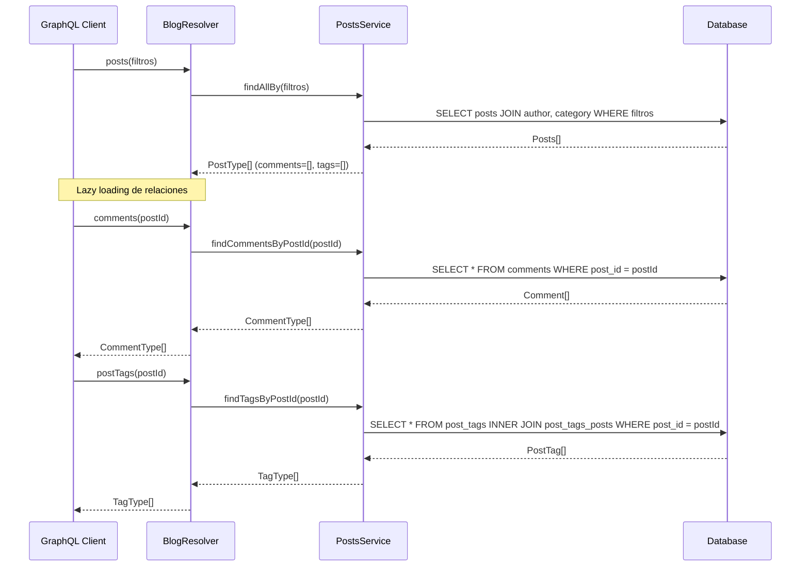

<p align="center">
  <a href="http://nestjs.com/" target="blank">
    
  </a>
  <a href="http://postgresql.org/" target="blank">
    
  </a>
</p>

<h2 align="center">API con NestJS + PostgreSQL</h2>

---

## 📑 Índice

1. [Descripción](#-descripción)
2. [Requisitos previos](#-requisitos-previos)
3. [Iniciar el proyecto](#-iniciar-el-proyecto)
4. [Migraciones](#-migraciones)
5. [Diagramas de arquitectura](#-diagramas-de-arquitectura)
   - [Flujo OAuth2 con Discord/Google](#flujo-oauth2-con-discordgoogle)
6. [Recursos](#-recursos)
7. [Licencia](#-licencia)

---

## 📖 Descripción

Este proyecto utiliza [NestJS](https://nestjs.com) como framework principal para construir un backend modular, escalable y orientado a microservicios.  
Incluye integración con **OAuth2 (Discord y Google)** para autenticación de usuarios, además de CQRS para separación de responsabilidades.

---

## ⚙️ Requisitos previos

Antes de iniciar asegúrate de tener instalado:

- [Node.js](https://nodejs.org/) v18+
- [Yarn](https://classic.yarnpkg.com/en/docs/install) o NPM
- Una base de datos (ej. PostgreSQL)

---

## 🚀 Iniciar el proyecto

```bash
# Instalar dependencias
$ yarn install

# Modo desarrollo
$ yarn start:dev

# Producción
$ yarn start:prod

# Pruebas unitarias
$ yarn test
```
## Migraciones

```bash
# Sintaxis general
$ yarn migration:create <ruta/nombre_de_la_migracion> -d <ruta-de-data-source>

# Aplicar migraciones
$ yarn migration:run -d <ruta-de-data-source>

# Ejemplos
# Creando una migración
$ yarn migration:create src/database/migrations/InitialSchema -d src/core/persistence/config/data-source.ts

# Ejecutando migraciones
$ yarn migration:run -d src/core/persistence/config/data-source.ts
```
---
## 🏗️ Diagramas de arquitectura
### Flujo OAuth2 con Discord/Google/Github
  ```mermaid
sequenceDiagram
    participant FE as Frontend
    participant OAuth2Provider as OAuth2 Provider
    participant AuthCtrl as AuthController
    participant Mediator as MediatorService
    participant CmdHandler as OAuth2CommandHandler
    participant Strategy as OAuth2Strategy
    participant DB as Database
    participant JWT as JwtService

    FE->>OAuth2Provider: GET /oauth2/authorize (client_id, redirect_uri, scope, state)
    OAuth2Provider-->>FE: Redirect con code + state
    FE->>AuthCtrl: GET /auth/oauth2/callback?code=XXX&state=YYY

    AuthCtrl->>Mediator: execute(new OAuth2Command(code, state))

    Mediator->>CmdHandler: dispatch OAuth2Command

    CmdHandler->>Strategy: exchangeCodeForToken(code)
    Strategy->>OAuth2Provider: POST /oauth2/token
    OAuth2Provider-->>Strategy: { access_token, refresh_token }

    CmdHandler->>Strategy: getUserProfile(access_token)
    Strategy->>OAuth2Provider: GET /api/user (Authorization: Bearer token)
    OAuth2Provider-->>Strategy: { id, email, username }

    CmdHandler->>DB: Buscar user_identity (provider=oauth2, provider_user_id=id)
    alt Usuario NO existe
        CmdHandler->>DB: INSERT User + INSERT UserIdentity
    else Usuario YA existe
        CmdHandler->>DB: UPDATE UserIdentity tokens
    end

    CmdHandler->>JWT: Generar JWT con { sub, email, provider }
    JWT-->>CmdHandler: token

    CmdHandler-->>Mediator: { user, token }
    Mediator-->>AuthCtrl: { user, token }
    AuthCtrl-->>FE: { user, token }

  ```
### Flujo de consultas Blog con GraphQL

